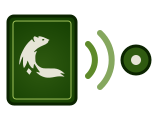

<p align="center">
  
</p>

<h1 align="center">NodeEcho</h1>

<p align="center">
  <strong>Node facts, echoed onto the pods running there, so namespace-scoped operators need no access to Nodes.</strong><br>
  A plain copy under server-side apply: nothing interpreted, nothing written on a healthy pod, never another writer's key.
</p>

<p align="center">
  <a href="https://fyannk.github.io/NodeEcho/"></a>
  <a href="https://github.com/fyannk/NodeEcho/actions/workflows/ci.yml"></a>
  <a href="LICENSE"></a>
  
  
  
</p>

NodeEcho is a Kubernetes controller. It watches Nodes and writes what you ask
for (the cordon, the taints you list, the labels and annotations you list)
onto the pods running there, as pod labels and annotations, and keeps them in
step with later Node changes. An operator scoped to its namespace then reads
its own pods and nothing else. CloudNativePG is the first consumer in view;
nothing in NodeEcho is specific to it.

> [!IMPORTANT]
> NodeEcho copies facts; it never decides that a node is draining or that a
> pod should move. Each consumer keeps its own policy, and has to read the
> keys: upstream CloudNativePG does not, so an integration is required. It is
> an early implementation, at version 0.1.0, and not production-ready.

> [!NOTE]
> An independent, personal project. It is not affiliated with, endorsed by or
> sponsored by the Kubernetes project, the CloudNativePG project, or any
> company.

## Why use it?

- **No Node access for your operators**: a namespace-scoped operator sees a cordon, a taint or a rack label on its own pods, without a ClusterRole on Nodes.
- **A plain echo**: values are copied as they are and follow the Node; nothing is derived.
- **A key only when it says something**: `unschedulable` is `"true"` or absent, so a healthy pod is never written.
- **Never another writer's key**: server-side apply with one field manager per rule; a key someone else owns is skipped with a Warning Event.
- **Fail safe**: until a valid configuration is loaded it writes and removes nothing, and an invalid one keeps the last valid one.

## What is included

| Component | Purpose |
|---|---|
| Controller | Watches Nodes and pods, applies the keys each rule asks for, removes them when they no longer apply |
| Rules | One ConfigMap: which pods, which Nodes, which taints, labels and annotations |
| Eviction webhook (optional) | Records eviction requests on the pods, and answers them |
| Admission policies | Keep others from forging the keys, and NodeEcho from writing anything else |
| Observability | Prometheus metrics, alerts with tests, a Grafana dashboard, JSON logs |
| Packaging | kustomize (`config/`), a Helm chart (`deploy/helm/nodeecho`), an OLM bundle and catalog (`deploy/olm`) |

## Quick start

Prerequisites: Docker, [k3d](https://k3d.io), kubectl and a clone of this
repository, for its manifests. The image is pulled from `ghcr.io`.

```sh
k3d cluster create nodeecho-demo --agents 1 \
  --kubeconfig-update-default=false --kubeconfig-switch-context=false
export KUBECONFIG=$(k3d kubeconfig write nodeecho-demo)

kubectl apply -k config/default
kubectl apply -k config/rules
kubectl -n nodeecho-system set image deployment/nodeecho manager=ghcr.io/fyannk/nodeecho:0.1.0
kubectl -n nodeecho-system rollout status deployment/nodeecho
```

NodeEcho is then running with no rule, and writes nothing. `config/rules`
is its empty rules ConfigMap, applied once: `config/default` is what you
apply again at an upgrade, and it leaves your rules alone.
[Getting started](https://fyannk.github.io/NodeEcho/docs/tutorials/getting-started/)
continues from here: one rule, then a cordon and a taint reaching a pod.

## Limitations

- Kubernetes 1.35 already puts zone and region labels on newly assigned pods (`PodTopologyLabelsAdmission`). NodeEcho is for what that does not cover: cordon and taints, custom labels and annotations, and changes after the pod is bound.
- No consumer reads the keys upstream yet; compatibility with individual forks remains to be validated.
- Tested on k3d only. EKS, GKE, AKS and OpenShift are not, nor is an upgrade between versions.

## Project status

Version 0.1.0, pre-1.0 and not production-ready. Contract v1 is implemented
and tested against a real API server (envtest) and end to end on k3d clusters
(Kubernetes 1.34, 1.36, 1.36 with `PodTopologyLabelsAdmission` off, and each
install path). The image, the chart and the OLM bundle are published and
signed; the contract may still change before 1.0. See
[Status](https://fyannk.github.io/NodeEcho/docs/overview/status/) for what is
missing before production.

## Documentation

The site is at [fyannk.github.io/NodeEcho](https://fyannk.github.io/NodeEcho/),
built from [`web/`](web/docs/).

- [Introduction](web/docs/overview/index.md) and [getting started](web/docs/tutorials/getting-started.md).
- [Installation](web/docs/operator/installation.md), [configuration](web/docs/operator/configuration.md), the [eviction webhook](web/docs/operator/eviction-webhook.md), [admission policies](web/docs/operator/admission-policies.md), [sizing](web/docs/operator/sizing.md) and [observability](web/docs/operator/observability.md).
- [Contract v1](web/docs/reference/contract.md): the keys a consumer sees on its pods, and what it may rely on.
- [Design notes](web/docs/design/design.md), and research on [CloudNativePG](web/docs/research/cloudnative-pg.md), the [ecosystem](web/docs/research/ecosystem.md) and [about twenty operators](web/docs/research/operators.md).
- [Development](web/docs/development.md): building, testing, the end-to-end and scale runs.

## Contributing

Contributions are welcome. Read [CONTRIBUTING.md](CONTRIBUTING.md) first: one
change per pull request, signed-off Conventional Commits, and AI assistance
disclosed wherever it appears. For larger changes, open an issue before
writing code. [AGENTS.md](AGENTS.md) holds the rules for anyone, human or
agent, working in the repository.

## Security

Report vulnerabilities privately, as described in [SECURITY.md](SECURITY.md).

## License

Apache-2.0. See [LICENSE](LICENSE). The IBM Plex fonts bundled with the
documentation site are under the SIL Open Font License; see
[`web/src/css/fonts/OFL.txt`](web/src/css/fonts/OFL.txt).
