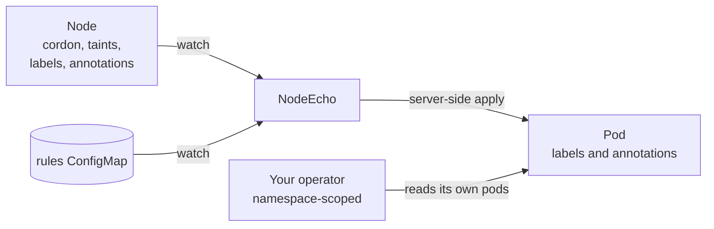

# Overview

NodeEcho is a Kubernetes controller that echoes Node facts onto the pods
running on those Nodes. An operator that only has rights in its own
namespace can then react to a cordoned node, a maintenance taint or a
failure domain by reading its own pods, without a ClusterRole on Nodes.

CloudNativePG is the first consumer in view. Nothing in NodeEcho is specific
to it: the [operators survey](../research/operators.md) lists about twenty
data and messaging operators that read Nodes for the same reasons.

## What it writes

For each rule, on the pods the rule selects:

| Node fact | Pod key (default) | Written |
| --- | --- | --- |
| `spec.unschedulable` | label `nodeecho.fyannk.dev/unschedulable` | `"true"`, or absent |
| taints whose key you list | annotation `nodeecho.fyannk.dev/taints` | a JSON list, or absent |
| labels you list | the same key, as a label or an annotation | the Node's value |
| annotations you list | the same key, as an annotation or a label | the Node's value |

A key is written only when it carries information, and follows later Node
changes. The [contract](../reference/contract.md) is the reference.

## How it works

- Rules in a ConfigMap select pods by namespace, pod and Node labels, and
  say what to echo.
- NodeEcho writes with server-side apply, one field manager per rule, and
  never overwrites a key another writer owns, such as a value from the pod
  template.
- When a rule, a pod or a Node changes so that a key no longer applies,
  NodeEcho removes it.

## What it is not

- **Not a policy engine.** NodeEcho never decides that a node is draining,
  healthy or ready. It copies facts; each consumer applies its own policy.
- **Not a replacement for Kubernetes topology labels.** From Kubernetes
  1.35, Kubernetes copies zone and region onto pods at binding; NodeEcho
  leaves those to Kubernetes unless told otherwise.
- **Not a hard dependency.** Consumers must keep working, with reduced
  behaviour, when NodeEcho is absent. An absent key means "not set" or "not
  projected yet".

## Where to go next

- [Getting started](../tutorials/getting-started.md): install it and watch a
  cordon reach a pod.
- [Configuration](../operator/configuration.md): write rules.
- [Status](status.md): what is done, and what is missing before production.
